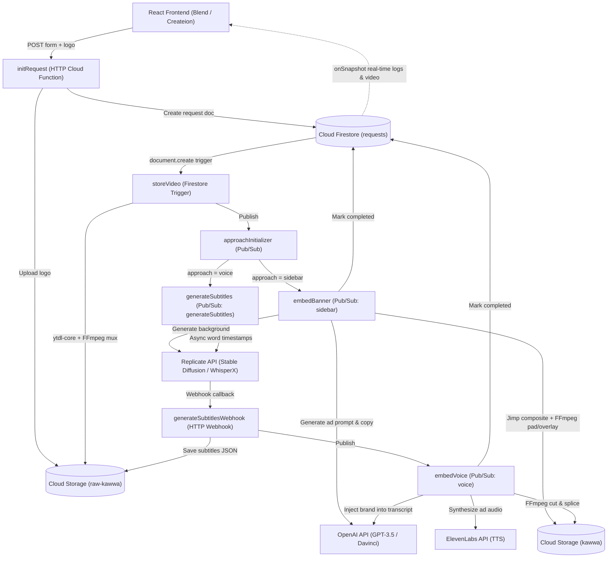

# Kawwa

[](https://github.com/umer2001/kawwa/actions/workflows/deploy_backend.yml)

Automated brand advertisement integration pipeline that embeds generated visual banners or synthesized voice promotions into YouTube videos for marketers and content creators.

## The Problem

Standard mid-roll video ads on platforms like YouTube, Vimeo, and Dailymotion interrupt playback, breaking the viewer's focus and shifting attention toward the skip button rather than the brand message. At the same time, producing native in-video sponsorships requires manual scriptwriting, voice recording or graphic design, and timeline editing—and repeating that work whenever a creator runs different brand campaigns for the same video across multiple social platforms.

## Why It Matters

- **Viewers** keep watching the original content without abrupt ad breaks that interrupt their train of thought.
- **Advertisers** get non-skippable brand placements—either a persistent visual sidebar or a voice mention woven into the video's transcript context—rather than an interruptive pre-roll or mid-roll clip.
- **Content Creators** can generate multiple sponsored versions of the same video for different brands or social platforms without reshooting or manually editing timelines.

## How It Works



Users submit a brand name, industry, description, PNG logo, YouTube URL, and integration approach (`sidebar` or `voice`) via [frontend/src/pages/Blend.jsx](frontend/src/pages/Blend.jsx). The [initRequest](backend/gcloud/initRequest.js) HTTP function validates the multipart payload with Yup, uploads the logo to Google Cloud Storage ([storageService.js](backend/core-functions/storageService.js)), and creates a document in Cloud Firestore ([request.js](backend/core-functions/firebase/request.js)).

Creating the Firestore document triggers [storeVideo](backend/gcloud/storeVideo.js), which downloads the 720p video and audio streams with `ytdl-core` ([ytdl.js](backend/core-functions/ytdl.js)), merges them using FFmpeg, caches the raw media in Cloud Storage by YouTube video ID, and publishes a message to [approachInitializer](backend/gcloud/approachInitializer.js). From there:
- **Sidebar approach**: [embedBanner](backend/gcloud/embedBanner.js) generates a scene prompt and marketing copy via OpenAI ([generatePrompt.js](backend/core-functions/openAI/generatePrompt.js)), generates a background image with Stable Diffusion on Replicate ([generateBg.js](backend/core-functions/replicateAI/generateBg.js)), composites the brand logo and copy into a 256x720 banner using Jimp ([generateBanner.js](backend/core-functions/bannerAds/generateBanner.js)), and pads and overlays the banner onto the video with FFmpeg ([combineAd.js](backend/core-functions/bannerAds/combineAd.js)).
- **Voice approach**: [generateSubtitles](backend/gcloud/generateSubtitles.js) submits the audio to WhisperX on Replicate ([getWordTimeStamps.js](backend/core-functions/replicateAI/getWordTimeStamps.js)) and registers [generateSubtitlesWebhook](backend/gcloud/generateSubtitlesWebhook.js) as the completion callback. Once word-level timestamps arrive, [embedVoice](backend/gcloud/embedVoice.js) uses OpenAI (`gpt-3.5-turbo-1106`) to insert a contextual brand mention tagged with `[modification-start]` and `[modification-end]`, resolves the surrounding word timestamps ([utils.js](backend/utils/utils.js)), synthesizes speech via ElevenLabs ([elevenLabs/index.js](backend/core-functions/elevenLabs/index.js)), and splices the synthesized audio segments into the video with FFmpeg ([ffmpeg.js](backend/core-functions/ffmpeg.js)).
- **Real-time status**: The frontend subscribes to the Firestore document with `onSnapshot` in [Createion.jsx](frontend/src/pages/Createion.jsx) to stream processing logs and render the completed video once uploaded.

### Key Decisions

- **Chose event-driven Google Cloud Functions + Cloud Pub/Sub over a monolithic server** ([.pulumi/index.js](.pulumi/index.js), [backend/gcloud](backend/gcloud)) because each pipeline stage (`storeVideo`, `embedBanner`, `generateSubtitles`, `embedVoice`) can scale independently based on demand and allocate stage-specific memory (512 MB vs. 8,192 MB) while staying within serverless pay-per-use and free-tier execution limits rather than paying for an always-on server.
- **Chose an asynchronous Replicate webhook callback over synchronous polling for WhisperX transcription** ([generateSubtitles.js](backend/gcloud/generateSubtitles.js), [generateSubtitlesWebhook.js](backend/gcloud/generateSubtitlesWebhook.js)) to avoid wasting compute time and Cloud Function execution quota waiting on external GPU inference, triggering the next step in the pipeline only when transcription completes.
- **Chose Cloud Firestore `onSnapshot` listeners over custom WebSockets or HTTP polling** ([Createion.jsx](frontend/src/pages/Createion.jsx), [request.js](backend/core-functions/firebase/request.js)) because the pipeline runs step-by-step across separate serverless functions; appending status entries to the document's `logs` array (`FieldValue.arrayUnion`) pushes real-time progress to the browser without polling or maintaining a stateful WebSocket server.
- **Chose Pulumi (Node.js) over manual console setup or shell scripts alone** ([.pulumi/index.js](.pulumi/index.js)) so the entire GCP environment—Storage buckets, IAM bindings, Pub/Sub topics, Firestore database, and Cloud Functions—can be replicated or scaled declaratively in code without manual console configuration.

### Tech Stack

JavaScript (ES6+), Node.js 16, React 18, Vite, Google Cloud Functions, Google Cloud Pub/Sub, Google Cloud Storage, Cloud Firestore, Pulumi, FFmpeg (`fluent-ffmpeg`), Jimp, OpenAI API, Replicate API (Stable Diffusion, WhisperX), ElevenLabs API, GitHub Actions.

### Tests

No tests yet. ([backend/test.js](backend/test.js) is a manual scratch script for invoking banner and RVC helper functions locally, and neither [backend/package.json](backend/package.json) nor [frontend/package.json](frontend/package.json) defines a test runner.)

### CI

[.github/workflows/deploy_backend.yml](.github/workflows/deploy_backend.yml) triggers on pushes affecting `backend/**`, sets up Node.js `16.x`, installs backend dependencies with Yarn, authenticates to Google Cloud using `secrets.GCP_CREDENTIALS`, and runs `yarn deploy` ([backend/scripts/deploy.sh](backend/scripts/deploy.sh)).

## Live Demo

- **Frontend UI**: https://kawwatube.netlify.app/ (Note: backend GCP and AI inference infrastructure is currently halted to avoid ongoing cloud and API costs.)

## How to Run It

### Prerequisites

- **Node.js**: `16.x` (matches the Cloud Functions `nodejs16` runtime in [.pulumi/index.js](.pulumi/index.js) and [.github/workflows/deploy_backend.yml](.github/workflows/deploy_backend.yml))
- **Yarn**: `1.x` (both `backend` and `frontend` use `yarn.lock`)
- **Pulumi CLI** & **Google Cloud SDK (`gcloud`)**: required for provisioning infrastructure and deploying Cloud Functions

### Environment Variables

Copy [.env.example](.env.example) to `backend/.env`, `.pulumi/.env`, and `frontend/.env` as applicable:

| Variable | Component | Purpose |
| --- | --- | --- |
| `GCP_PROJECT_ID` | Backend, Pulumi | Google Cloud project identifier |
| `SERVICE_ACCOUNT_EMAIL` | Pulumi | Service account email granted Storage, Pub/Sub, and Firestore IAM roles |
| `FIRESTORE_DB_NAME` | Backend | Cloud Firestore database name |
| `RAW_BUCKET_NAME` | Backend | GCS bucket for raw uploaded logos, downloaded YouTube videos, audio, and subtitles |
| `TARGET_BUCKET_NAME` | Backend | Publicly readable GCS bucket for processed output videos |
| `TEMP_FOLDER` | Backend, Pulumi | Temporary filesystem directory for intermediate FFmpeg and image files (e.g. `/tmp`) |
| `APPROACH_INITIALIZER_TOPIC` | Backend | Pub/Sub topic triggered after raw video storage |
| `SIDEBAR_TOPIC` | Backend | Pub/Sub topic triggering the `embedBanner` function |
| `VOICE_INIT_TOPIC` | Backend | Pub/Sub topic triggering the `generateSubtitles` function |
| `VOICE_TOPIC` | Backend | Pub/Sub topic triggering the `embedVoice` function |
| `AFTER_SUBTITLE_WEEBHOOK_URL` | Backend | Public HTTPS URL of `generateSubtitlesWebhook` for Replicate callbacks |
| `OPENAI_API_KEY` | Backend | OpenAI API key for prompt/copy generation and transcript modification |
| `REPLICATE_API_TOKEN` | Backend | Replicate API token for Stable Diffusion and WhisperX predictions |
| `ELEVEN_LABS_API_KEY` | Backend | ElevenLabs API key for text-to-speech synthesis |
| `ELEVEN_LABS_VOICE_ID` | Backend | ElevenLabs target voice ID |
| `RVC_HOST_URL` | Backend | Base URL of the RVC voice conversion instance |
| `NODE_ENV` | Backend | Set to `development` to log `ytdl-core` download progress |
| `VITE_INIT_REQUEST_URL` | Frontend | HTTPS trigger URL for the deployed `initRequest` Cloud Function |
| `VITE_FIREBASE_API_KEY` | Frontend | Firebase web app API key |
| `VITE_FIREBASE_AUTH_DOMAIN` | Frontend | Firebase authentication domain |
| `VITE_FIREBASE_PROJECT_ID` | Frontend | Firebase/GCP project ID |
| `VITE_FIREBASE_STORAGE_BUCKET` | Frontend | Firebase storage bucket domain |
| `VITE_FIREBASE_MESSAGING_SENDER_ID` | Frontend | Firebase Cloud Messaging sender ID |
| `VITE_FIREBASE_APP_ID` | Frontend | Firebase web application ID |

### Install & Run

1. **Provision GCP infrastructure and deploy Cloud Functions with Pulumi**:
   ```bash
   cd .pulumi
   npm install
   npm run deploy
   ```

2. **Run a backend Cloud Function locally**:
   ```bash
   cd backend
   yarn install
   yarn start
   ```
   (`yarn start` runs `npx functions-framework --target=storeVideo [--signature-type=http]` as defined in [backend/package.json](backend/package.json).)

3. **Run the frontend locally**:
   ```bash
   cd frontend
   yarn install
   yarn dev
   ```
   Other verified frontend scripts in [frontend/package.json](frontend/package.json): `yarn build`, `yarn lint`, and `yarn preview`.

## License

Distributed under the [MIT License](LICENSE).

